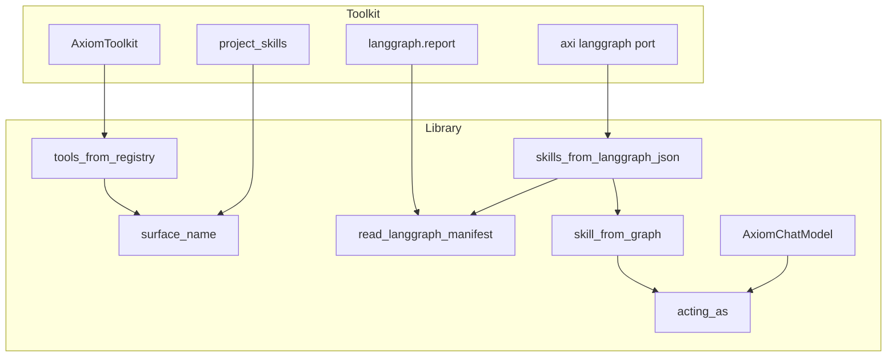
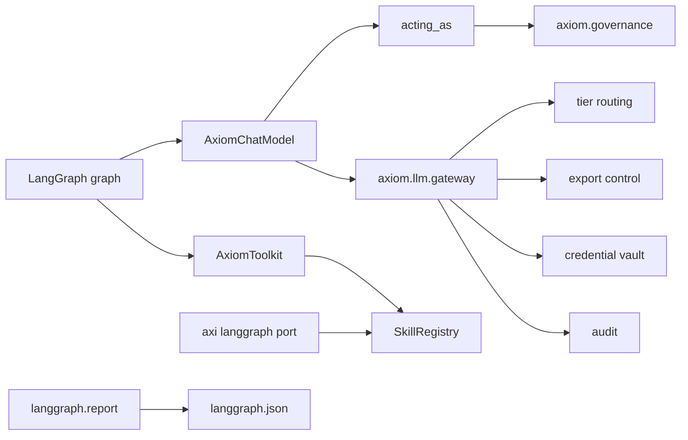
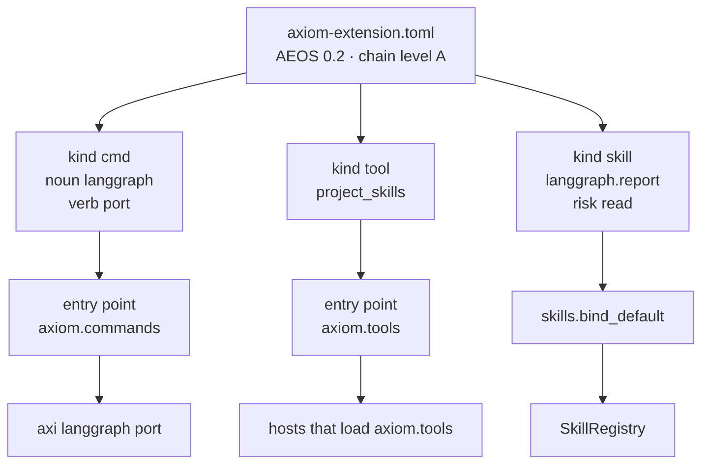

# axiom-ext-langgraph

An AEOS extension that runs LangChain and LangGraph as a client of Axiom.

A graph built with this package calls the Axiom gateway for every model turn, projects tools from the Axiom skill registry, and runs under the actor bound for that call. Tier routing, export-control enforcement, the credential vault, and audit are the platform's. LangGraph stays the runtime. It does not bring a gateway, a registry, or an identity of its own.

The extension is two surfaces:

- The **toolkit** is what an agent or an operator invokes.
- The **library** is the importable API that toolkit is built on.

`aeos_version` is `0.2.0`. Chain level is A.

## The four singles

A LangGraph run is a rendering of the platform when each of these stays single.

| | What stays single | Where |
|---|---|---|
| 1 | LLM gateway | `AxiomChatModel` calls `axiom.llm.gateway` |
| 2 | State and audit record | Declared, unwired. See [Checkpoint](#checkpoint) |
| 3 | Tool registry | `AxiomToolkit` and `tools_from_registry` project `SkillRegistry` |
| 4 | Identity | `acting_as` binds the actor; the chat model passes that principal on every call |

## Components



`AxiomToolkit.get_tools()` is `tools_from_registry`. Name the skills you want. With no names, only skills that opted into the `agent_tool` surface are projected.

`project_skills` is the same spelling with no registry and no model call. You pass each skill's name, description, and inputs. `data.install` becomes the LangChain name `data_install`, because a dot is not a legal function-calling name. CLI and MCP names stay on the platform's `__` projector.

`axi langgraph port` reads a `langgraph.json` and registers each graph as a skill. `langgraph.report` reads the same document and returns the capability names. It does not register them.

`skill_from_graph` adapts `invoke(state)` to `(params, ctx) -> SkillResult`, binds the skill context's principal with `acting_as`, and returns the final state. A graph that raises becomes `ok=False`.

## Where it sits in the Axiom runtime



Import of this package strips LangChain-family telemetry configuration from the process before any sibling module reads it. A graph cannot be pointed at a provider. `AXIOM_LANGGRAPH_ROUTING_TIER` pins the tier for the process. A constructor argument wins. An unrecognised tier is refused.

The surfaces this shim touches are the typed table in `axiom_ext_langgraph/surfaces.py`:

| Surface | Mode |
|---|---|
| `axiom.llm.gateway` | read |
| `axiom.infra.skills.SkillRegistry` | write-extension-point |
| `axiom.governance` actor context | write-extension-point |
| LangGraph checkpoint store | never |

Projection reads skills other extensions already registered. This extension writes `langgraph.report` through `bind_default`, and `port` writes the caller's graphs through the same registry API. The actor binding is restored when the run ends. The checkpoint store is not touched.

## Where it sits in AEOS

This is a standalone extension (`builtin = false`), purpose-named `axiom_ext_langgraph`, distribution name `axiom-ext-langgraph`. The manifest is `axiom-extension.toml`. The package beside it is the compound layout.



The extension opts out of publishing an MCP server. It projects the platform's registry onto LangGraph. It produces no measured values, so its uncertainty posture is `not-applicable`.

## Install

```bash
pip install axiom-ext-langgraph
pip install "axiom-ext-langgraph[graph]"
```

The base install is the chat model, the toolkit, and the library. `langchain-core` is a dependency of this package. It is not a dependency of Axiom: hosting LangGraph costs the platform nothing in its own dependency graph.

The `graph` extra adds `langgraph` and `langchain`, which is where `create_agent` lives.

## Use

```python
from langchain.agents import create_agent
from axiom_ext_langgraph import AxiomChatModel, AxiomToolkit, acting_as

model = AxiomChatModel(routing_tier="export_controlled")
tools = AxiomToolkit(registry=registry, names=["data.install", "telemetry.series"]).get_tools()

agent = create_agent(model, tools)

with acting_as(principal):
    result = agent.invoke({"messages": [("user", "what happened on Tuesday?")]})
```

`tools_from_registry(registry, names)` is the same projection. `create_react_agent` from `langgraph.prebuilt` still builds a graph. It moved to `langchain.agents.create_agent` in LangChain 1.0. `examples/with_tools.py` prefers the current constructor and falls back when `langchain` is absent.

Runnable copies live in `axiom_ext_langgraph/examples/`. Start with `ask_once` (one model call) and then `with_tools`. Their tests need no gateway, no network, and no credentials.

### Pinning a tier for the process

```bash
export AXIOM_LANGGRAPH_ROUTING_TIER=export_controlled
```

This is the same idea as `AXIOM_BRIDGE_ROUTING_TIER` on the Anthropic and OpenAI ingress, so a facility sets both bridges the same way.

### Port a project

```bash
axi langgraph port langgraph.json --namespace moose
```

That is `python -m axiom_ext_langgraph.port`. Each declared graph becomes the capability `moose.<graph>`. The registration opts into the `cli`, `mcp`, `agent_tool`, and `skill_md` surfaces, and the platform projects those from the one skill. The report skill returns the names and leaves the registry alone.

## It fails closed

A gateway response with `success=False` raises `AxiomGatewayUnavailable`. The graph stops. It does not branch on placeholder text.

A failed skill raises `SkillInvocationError`. The graph sees a tool error.

Streaming raises `NotImplementedError`. LangChain's default would call `_generate` and yield one chunk, which looks like streaming works. The gateway can stream. This package does not pretend it does.

## Checkpoint

LangGraph's checkpointer is a second state store. Two checkpoint stores fork the record of what an agent did. The durable, resumable checkpoint belongs on the Axiom store, beside the platform's approval gate, and that primitive has an owner. This extension declares the checkpoint store in mode `never` and does not stub it.

## Status

The chat model, toolkit, library, graph port, and actor binding are implemented and tested. The checkpoint is the deliberate gap. Chain level is A. Releases are declared to require a Sigstore signature. See `AGENTS.md`.

---

_Copyright (c) 2026 The University of Texas at Austin and B-Tree Labs. Apache-2.0 licensed._
